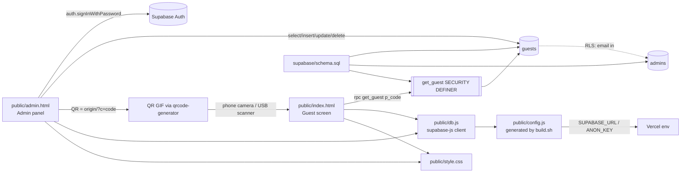

# Knowledge Graph — guestlogin

| Node | Owns | Depends on |
|---|---|---|
| `supabase/schema.sql` | `guests(code,name,company,tier VIP/REGULAR,table_no)`, `admins(email)`, RLS, `get_guest()` | — |
| `public/admin.html` | login, CRUD, search, QR modal/download (auto-opens after add/edit) | `db.js`, `guests` (RLS → `admins`), public/qrcode.js (vendored qrcode-generator 1.4.4, MIT) |
| `public/index.html` | VIP/REGULAR pass display; accepts `?c=` or scanner input (code or URL) | `db.js`, `get_guest` |
| `public/db.js` | single Supabase client | `config.js`, supabase-js 2.45.4 (jsdelivr) |
| `build.sh` → `public/config.js` | injects public URL + anon key at Vercel build | Vercel env `SUPABASE_URL`/`NEXT_PUBLIC_*`, `SUPABASE_ANON_KEY`/`NEXT_PUBLIC_*`/`SUPABASE_PUBLISHABLE_KEY` |
| `vercel.json` | static output `public/`, clean URLs (`/admin`) | `build.sh` |

Invariants
- QR encodes `<origin>/?c=<code>`; deleting a guest invalidates its QR; editing keeps it.
- Anon can only read one guest by exact code (12 hex chars); never list.
- Admin access = Auth user **and** row in `admins`.
