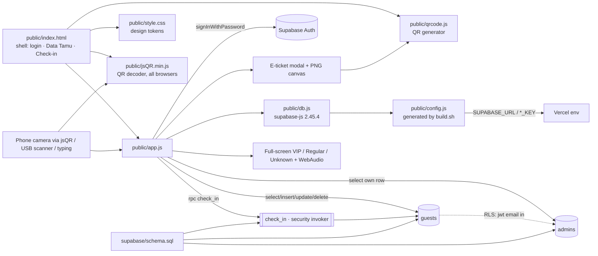

# Knowledge Graph — guestlogin (CBN Guest Check-in)

Design source: `CBN Guest Check-in.dc.html` (Claude Design prototype, localStorage) → rebuilt on Supabase.

| Node | Owns | Depends on |
|---|---|---|
| `supabase/schema.sql` | `guests(code CBN-XXXXXXX, name, company, tier VIP/REGULAR, table_no, checked_in_at)`, `gen_guest_code()`, `admins(email)`, RLS, `check_in()`; drops old `get_guest()` | — (re-runnable, upgrades v1) |
| `public/app.js` | `EVENT`, `RESET_SEC`, `SOUND` constants; admin CRUD/filter/search/stats; ticket + PNG; check-in flow, log (in-memory, per device); camera; sound | `db.js`, `qrcode`, `jsQR`, `check_in`, `guests`, `admins` |
| `public/index.html` | static markup for all views | `style.css`, `config.js`, `qrcode.js`, `jsQR.min.js`, `app.js`, Google Fonts (Plus Jakarta Sans, JetBrains Mono, Material Symbols Rounded) |
| `public/style.css` | design tokens (`--blue #1D5BFF`, `--ink #0A1226`, gradients) + all component styles | — |
| `build.sh` → `public/config.js` | injects public Supabase URL + key at Vercel build | Vercel env `SUPABASE_URL`, `SUPABASE_PUBLISHABLE_KEY` (or `*_ANON_KEY`, `NEXT_PUBLIC_*`) |
| `vercel.json` | static output `public/`, `/admin` → `/` redirect | `build.sh` |

Invariants
- QR encodes the bare code (`CBN-XXXXXXX`); ticket never shows tier — tier is revealed only on the scan screen.
- Check-in is staff-only (authenticated + in `admins`); first scan → `ok`, later → `again`, unknown → no row.
- Old v1 QR links (`/?c=code`) still check in: `checkIn()` extracts `c=` and codes were upper-cased.
- `?view=checkin` opens the Check-in tab directly.
- Camera scan decodes frames with jsQR (no BarcodeDetector), so it works on iPhone Safari and Android; needs HTTPS + camera permission.
